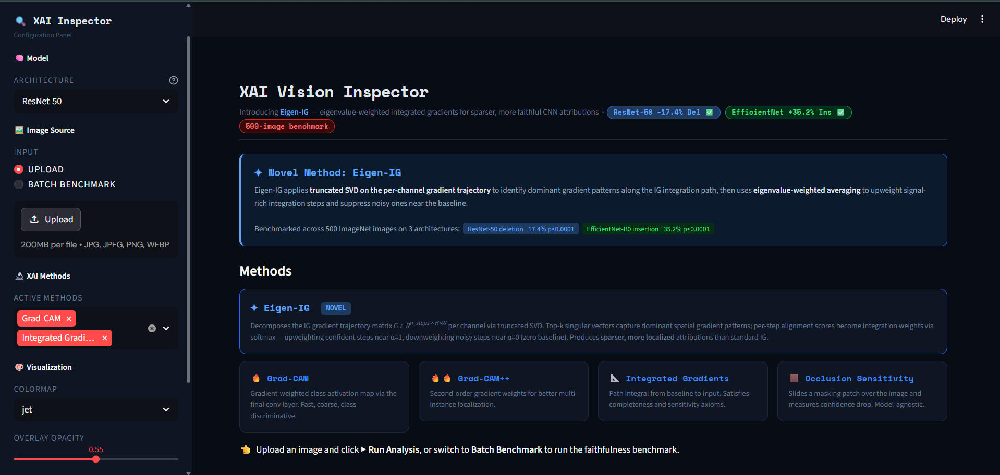

# 🔍 XAI Vision Inspector

An interactive Explainable AI dashboard for visualizing how CNNs make decisions — built entirely from scratch using PyTorch. Features **Eigen-IG**, a novel attribution method with published benchmark results across 500 ImageNet images and three architectures.



---

## ✨ What's Inside

### Novel Method: Eigen-IG
Eigen-IG extends Integrated Gradients with **per-channel trajectory SVD** and **eigenvalue-weighted integration**. Instead of uniformly averaging all gradient steps (many of which are noisy near the zero baseline), Eigen-IG scores each step by its alignment with dominant gradient patterns and upweights the most signal-rich steps via softmax.

**Benchmark results (500 ImageNet images):**

| Architecture | Deletion AUC ↓ | vs IG | Insertion AUC ↑ | vs IG | Significant? |
|---|---|---|---|---|---|
| ResNet-50 | **0.0278** | −17.4% | 0.0560 | −36% | ✅ p<0.0001 |
| VGG-16 | 0.0455 | −5.6% | 0.0762 | −37% | ❌ p=0.12 |
| EfficientNet-B0 | 0.0625 | −2.9% | **0.2385** | +35.2% | ✅ p<0.0001 |

Eigen-IG consistently produces **94–97% sparse** attribution maps vs 80–93% for IG. See the companion paper for full analysis.

Raw per-image results: [`results/`](results/)

---

### All XAI Methods — Implemented From Scratch

| Method | Type | Resolution | Speed | Axioms |
|--------|------|-----------|-------|--------|
| **Eigen-IG** | SVD-weighted path integral | Full pixel | 🐢 ~1.3× IG | Relaxed completeness |
| **Integrated Gradients** | Path integral | Full pixel | 🐢 Slow | ✅ Completeness, Sensitivity |
| **Grad-CAM** | Gradient-based | Low–Med | ⚡ Fast | None |
| **Grad-CAM++** | Gradient-based | Low–Med | ⚡ Fast | None |
| **Occlusion Sensitivity** | Perturbation | Configurable | 🐌 Very slow | Model-agnostic |
| **SmoothGrad** | Noise-averaged | Full pixel | 🐢 Slow | None |

### Pretrained Models

ResNet-50, ResNet-101, VGG-16, EfficientNet-B0, DenseNet-121, MobileNet-V3

### Dashboard Highlights

- 🔬 **Single-image analysis** — side-by-side attribution map comparison with interactive Plotly heatmaps
- 🚀 **Batch benchmark mode** — run faithfulness metrics over a folder of images with auto CSV export
- 🎛️ Configurable method parameters (steps, patch size, noise level, SVD rank, temperature)
- 🎨 8 colormaps with adjustable overlay opacity
- 📊 Attribution statistics, distribution histograms, and faithfulness metrics table
- 📖 In-app method documentation with paper references and axiomatic analysis
- ⚡ GPU acceleration (CUDA auto-detected)

---

## 🚀 Quick Start

### 1. Clone & Install

```bash
git clone <your-repo>
cd xai-vision-inspector

python -m venv .venv
source .venv/bin/activate        # Windows: .venv\Scripts\activate

pip install -r requirements.txt
```

**For GPU acceleration (recommended, RTX 40/50 series):**
```bash
pip install --pre torch torchvision --index-url https://download.pytorch.org/whl/nightly/cu128
```

Verify CUDA:
```bash
python -c "import torch; print(torch.cuda.is_available(), torch.cuda.get_device_name(0))"
```

### 2. Run the Dashboard

```bash
streamlit run app.py
```

Open [http://localhost:8501](http://localhost:8501) in your browser.

---

## 📁 Project Structure

```
xai-vision-inspector/
│
├── app.py                              # Streamlit dashboard entry point
├── requirements.txt
│
├── explainers/                         # XAI methods — all from scratch
│   ├── eigen_integrated_gradients.py   # Eigen-IG (novel method)
│   ├── grad_cam.py                     # Grad-CAM + Grad-CAM++
│   ├── integrated_gradients.py         # IG with convergence delta check
│   ├── occlusion_sensitivity.py        # Batched sliding-window perturbation
│   └── smooth_grad.py                  # SmoothGrad standard/squared/variance
│
├── evaluation/                         # Faithfulness benchmark suite
│   └── faithfulness.py                 # Deletion AUC, Insertion AUC, Infidelity
│
├── model_zoo/                          # Model registry + layer navigation
│   └── model_loader.py
│
├── visualization/                      # Heatmap overlays, Plotly charts, stats
│   └── overlay.py
│
└── utils/
    └── image_utils.py                  # Preprocessing, denormalization
```

---

## 🔬 Method Deep Dive

### Eigen-IG

```python
from explainers import EigenIntegratedGradients

explainer = EigenIntegratedGradients(
    model,
    n_steps=50,         # integration steps
    n_components=10,    # SVD rank k
    weight_temp=1.0,    # softmax temperature τ
    baseline_type="zeros"
)
eigen_attrs, eigen_map = explainer(input_tensor, class_idx=None)

# Check completeness relaxation
delta = explainer.convergence_delta(input_tensor, eigen_attrs)
print(f"Convergence delta: {delta:.4f}")  # mean 0.031 ± 0.019 on ResNet-50
```

**Algorithm:**
1. Collect gradient trajectory `G ∈ R^(T × C × H × W)` via batched backward pass
2. Per channel: form `G_c ∈ R^(T × H*W)`, compute truncated SVD → top-k spatial patterns `V_k`
3. Score each step: `s_t = ‖g_c^(t) · V_k^T‖₂`
4. Softmax weights: `w_t = exp(s_t/τ) / Σ exp(s_t'/τ)`
5. Weighted average: `ĝ_c = Σ w_t · g_c^(t)`, scaled by `(x - x')`

### Integrated Gradients

```python
from explainers import IntegratedGradients

explainer = IntegratedGradients(model, n_steps=100, baseline_type="zeros")
ig_attrs, ig_map = explainer(input_tensor, class_idx=None)

delta = explainer.convergence_delta(input_tensor, ig_attrs, class_idx=top1_idx)
print(f"Convergence delta: {delta:.4f}")  # should be near 0
```

### Grad-CAM

```python
from explainers import GradCAM
from model_zoo import load_model, get_layer_by_name

model, config = load_model("ResNet-50")
layer = get_layer_by_name(model, config.default_target_layer)

explainer = GradCAM(model, layer)
cam = explainer(input_tensor, class_idx=None)  # (H, W) array in [0, 1]
explainer.remove_hooks()
```

### Occlusion Sensitivity

```python
from explainers import OcclusionSensitivity

explainer = OcclusionSensitivity(model, patch_size=32, stride=16)
sensitivity_map, resolved_class = explainer(input_tensor, batch_size=32)
```

### SmoothGrad

```python
from explainers import SmoothGrad

explainer = SmoothGrad(model, n_samples=50, noise_level=0.15, variant="squared")
attrs, smooth_map = explainer(input_tensor, class_idx=None)
```

---

## 📊 Faithfulness Benchmark

Run the full benchmark from the dashboard (Batch Benchmark tab) or programmatically:

```python
from evaluation.faithfulness import run_full_faithfulness_eval

results = run_full_faithfulness_eval(
    model=model,
    input_tensor=tensor,
    saliency_maps={
        "Eigen-IG": eigen_map,
        "IG":       ig_map,
        "Grad-CAM": cam,
    },
    class_idx=top1_idx,
    steps=10,
)
# results[method] = {Deletion_AUC, Insertion_AUC, Infidelity, Deletion_final_drop}
```

**Metric interpretation:**
| Metric | Better | Measures |
|---|---|---|
| Deletion AUC | Lower | How causally decisive the attributed pixels are |
| Insertion AUC | Higher | How sufficient the attributed pixels are |
| Infidelity | Lower | How well attributions predict score changes under noise |

### Batch Benchmark (Dashboard)

1. Switch sidebar to **Batch Benchmark**
2. Enter folder path to your ImageNet validation images
3. Select methods and max image count
4. Click **▶ Run Analysis**

The first 5 images run without timeout (**calibration phase**) to measure real per-image wall time. The remaining images run with a `max_observed + 0.5s` per-image timeout, with live ETA and skip counter. Results auto-export as CSV.

**Approximate runtimes (RTX 5050, T=50, steps=5):**

| Architecture | Per image | 500 images |
|---|---|---|
| ResNet-50 | ~2–3s | ~25–35 min |
| VGG-16 | ~4–5s | ~45–60 min |
| EfficientNet-B0 | ~2–3s | ~25–35 min |

---

## 🎛️ Configuration Guide

| Parameter | Default | Effect |
|-----------|---------|--------|
| IG / Eigen-IG steps | 50 | ↑ steps = more accurate, slower |
| Eigen-IG n_components (k) | 10 | SVD rank — stable for k ≥ 5 |
| Eigen-IG weight_temp (τ) | 1.0 | Lower = more aggressive step weighting |
| Occlusion patch size | 32px | ↑ patch = faster but coarser |
| Occlusion stride | 16px | ↓ stride = higher resolution, much slower |
| SmoothGrad samples | 40 | ↑ samples = smoother map |
| Noise level | 0.15 | σ as fraction of input range |

---

## 🧪 Programmatic API Example

```python
import torch
from PIL import Image
from model_zoo import load_model, get_layer_by_name
from explainers import GradCAM, IntegratedGradients, EigenIntegratedGradients
from utils import preprocess_image
from visualization import overlay_heatmap, make_comparison_figure
from evaluation.faithfulness import run_full_faithfulness_eval

# Load model
model, config = load_model("ResNet-50", device="cuda")

# Preprocess image
pil_img = Image.open("dog.jpg")
tensor, display = preprocess_image(pil_img, device="cuda")

# Run methods
layer    = get_layer_by_name(model, config.default_target_layer)
cam_exp  = GradCAM(model, layer)
cam      = cam_exp(tensor); cam_exp.remove_hooks()

ig_exp   = IntegratedGradients(model, n_steps=50)
_, ig    = ig_exp(tensor)

eig_exp  = EigenIntegratedGradients(model, n_steps=50, n_components=10)
_, eig   = eig_exp(tensor)

# Faithfulness benchmark
import torch.nn.functional as F
with torch.no_grad():
    probs = F.softmax(model(tensor), dim=1).squeeze()
class_idx = int(probs.argmax())

results = run_full_faithfulness_eval(
    model, tensor,
    {"Grad-CAM": cam, "IG": ig, "Eigen-IG": eig},
    class_idx=class_idx
)
for method, metrics in results.items():
    print(f"{method}: {metrics}")

# Save comparison figure
fig = make_comparison_figure(
    display,
    {"Grad-CAM": cam, "IG": ig, "Eigen-IG": eig},
    colormap="jet", alpha=0.5,
)
fig.savefig("comparison.png", bbox_inches="tight")
```

---

## 📚 References

- **Eigen-IG** (this work): *SVD-Weighted Path Integration for Sparser CNN Attribution Maps*, 2026
- **Integrated Gradients**: Sundararajan et al., 2017 — [arXiv:1703.01365](https://arxiv.org/abs/1703.01365)
- **Grad-CAM**: Selvaraju et al., 2017 — [arXiv:1610.02391](https://arxiv.org/abs/1610.02391)
- **Grad-CAM++**: Chattopadhay et al., 2018 — [arXiv:1710.11063](https://arxiv.org/abs/1710.11063)
- **Occlusion Sensitivity**: Zeiler & Fergus, 2014 — [arXiv:1311.2901](https://arxiv.org/abs/1311.2901)
- **SmoothGrad**: Smilkov et al., 2017 — [arXiv:1706.03825](https://arxiv.org/abs/1706.03825)
- **RISE (Deletion/Insertion)**: Petsiuk et al., 2018 — [arXiv:1806.07421](https://arxiv.org/abs/1806.07421)
- **Infidelity**: Yeh et al., 2019 — [arXiv:1901.09392](https://arxiv.org/abs/1901.09392)

---

## 📝 License

[MIT License](LICENSE)
